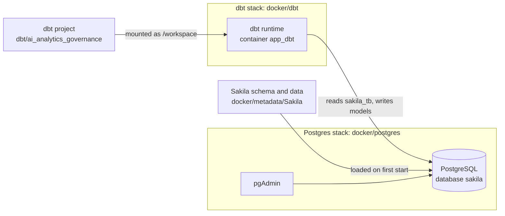

# Architecture

The project runs in two Docker stacks that share one network. The dbt project and its Docker runtime live in separate folders, so the transformation code does not depend on how it is run.

## Folders

| Folder | Holds | Kind |
|---|---|---|
| `docker/postgres/` | Compose file, init script, pgAdmin server list, `.env` | Runtime |
| `docker/metadata/Sakila/` | Sakila schema and data scripts | Source data |
| `docker/dbt/` | Compose file, Dockerfile, `profiles.yml`, `.env` | Runtime |
| `dbt/ai_analytics_governance/` | Models, seeds, tests, macros | Transformation code |
| `docs/` and `mkdocs.yml` | This site | Documentation |
| `Makefile` | Every command, listed by `make help` | Task runner |

## Key choices

- **One network, two stacks.** The Postgres stack creates the network `ai-governance-net`, and the dbt stack joins it, so dbt reaches the database by the hostname `postgres`.
- **One place for credentials.** The Postgres passwords live only in `docker/postgres/.env`. The dbt container loads that file, and `profiles.yml` reads the values with `env_var()`, so it contains no secrets and is safe to commit.
- **Code apart from runtime.** `dbt/` holds what dbt builds, and `docker/dbt/` holds how and where it runs. Moving to another database or to the cloud changes the runtime folder, not the models.
- **Files owned by you.** The dbt container runs as your own user, so the files dbt creates can be edited without `sudo`.
- **Schemas.** The Sakila tables are in the `sakila_tb` schema. dbt writes its models to `public`.
