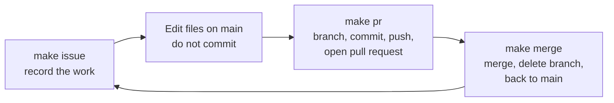

# Workflow

Every change follows the same path: write an issue, make the change on a branch, merge it through a pull request. The Makefile wraps each step, and `make help` lists them under "Git workflow".



## Commands

| Command | What it does |
|---|---|
| `make issues` | List the open issues |
| `make issue TITLE="..." BODY="..." LABEL=x` | Create an issue assigned to you. `BODY` defaults to the title, `LABEL` to `enhancement` |
| `make pr BRANCH=x MSG="..." FILES="a b"` | Create the branch, commit, push and open a pull request. `FILES` defaults to everything |
| `make merge` | Merge the current branch's pull request, delete the branch, and return to an updated `main` |
| `make ship BRANCH=x MSG="..."` | `make pr`, then `make merge` |

`make pr` and `make ship` show the branch, message and files, and change nothing until you type `yes`.

## Example

```bash
make issues
make issue TITLE="Build the Sakila staging layer"
# ...edit files on main...
make pr BRANCH=staging-layer MSG="Add Sakila staging models (closes #N)" FILES="dbt"
# ...more commits on the branch if needed: git add, git commit, git push...
make merge
```

## Rules learned the hard way

- **Put the right issue number in `closes #N`.** Take it from `make issues`. With the wrong number, the issue stays open after the merge.
- **Commit before you experiment.** `git reset --hard` deletes uncommitted work for good.
- **Delete a branch only after its merge.** `make merge` does it in that order.
- **Clear stale branch names** with `git fetch --prune`.
- **A `$` in a message** must be typed as `$$`, because `make` reads it first.
